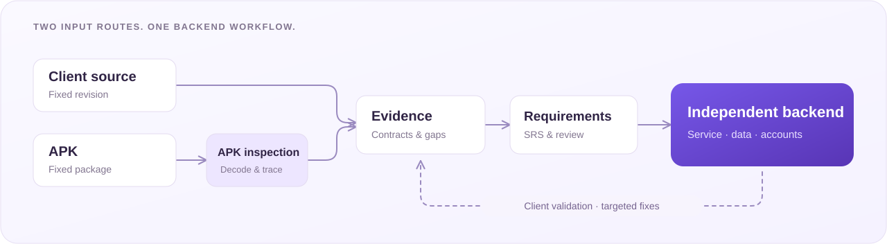

**English** · [简体中文](README.zh-CN.md)

# REA-Backend

### From client source or APK to runnable backends.

Discover requirements. Build an independent service. Validate it with the client.

[How it works](#how-it-works) · [What you get](#what-you-get) · [Getting started](#getting-started) · [Documentation](#documentation)

  

REA-Backend uses Android client source code or an APK to discover backend requirements, write a reviewed software requirements specification (SRS), and build an independent service. The source route investigates the client directly; the APK route collects evidence through inspection and decoding tools. Both follow the same requirements, implementation, and validation workflow.

Within the declared feature scope, the existing client connects to a service that maintains its own accounts, business data, and persistence. Each run records the permitted inputs, any client connection adaptations, and remaining gaps. The original server implementation is excluded from the default build inputs.

> [!NOTE]
> **Documentation preview.** This repository describes the existing pipeline and its planned standalone release. Preparing and verifying the standalone package is in progress; executable pipeline code is not included yet.

## Why REA-Backend

- **Two input routes, one workflow.** Use client source or an APK while preserving the evidence boundaries of each route.
- **Requirements grounded in client behavior.** Trace request construction, response consumption, state changes, retries, resources, and synchronization.
- **A specification you can review.** Link requirements to evidence, retain unknowns, and review critical behavior before implementation.
- **Real-client feedback from the start.** Validate an initial complete workflow, then expand and check the final build.
- **A traceable build history.** Pin inputs and methods, preserve failures, and bind requirements, implementation, and validation to specific artifacts.

## How it works

| Stage | Work | Output |
| --- | --- | --- |
| **1. Prepare** | Pin the client version, input permissions, and scope. Inspect and decode APK inputs. | Input identity and analysis materials |
| **2. Discover** | Trace calls, consumers, state, resources, and complete workflows. Record findings and unresolved questions. | Evidence and resumable analysis records |
| **3. Specify** | Freeze the analysis baseline, write backend requirements, and review critical behavior independently. | Reviewed SRS and version bindings |
| **4. Build** | Implement the service from the SRS and evidence collected through the same route. | Service code and requirement-to-code mapping |
| **5. Validate** | Exercise protocol behavior, persistence, resources, and selected workflows with the actual client. | Early and final validation records |
| **6. Deliver** | Package the service, dependencies, instructions, and supporting records. | Independently runnable backend package |

Validation feeds back into the appropriate stage: a requirements gap returns to discovery and specification; an implementation defect returns to the service; an environment issue returns to runtime setup. Previous failures and baselines remain available.

A host coding agent performs the investigation, writing, and programming. The CLI checks records, freezes artifacts, packages services, and executes explicit validation plans. Model orchestration is supplied by the host environment.

## What you get

A completed run produces:

| Artifact | What it contains |
| --- | --- |
| **Backend SRS** | Functional requirements, interface contracts, data models, state transitions, acceptance criteria, and known gaps |
| **Analysis and review records** | Evidence references, investigation history, independent review findings, and method versions |
| **Independent service** | Backend code, dependencies, persistence, and startup instructions for the declared scope |
| **Implementation mapping** | How each requirement is implemented, partially implemented, or deferred, including local design decisions |
| **Validation evidence** | Checks, client actions, storage assertions, failures, and the exact build exercised |

The generated service runs independently of the analysis tools and coding agent. Original client materials are retained separately for reproducibility and are not automatically redistributed in the build package.

## Getting started

Start with the engineering documentation:

1. Read the [engineering specification](docs/engineering.md) for inputs, stages, handoffs, and quality requirements.
2. Review the [release plan](docs/release-plan.md) for standalone packaging, installation checks, and the first public release scope.

Standalone package preparation is ongoing. Installation instructions will accompany the verified package. The initial open-source scope is the reusable pipeline; generated app services and input materials are maintained separately.

## Existing examples

The pipeline has been exercised through both source and APK routes on **wallabag**, **ReadYou**, **Tempo**, **Grocy**, and **Nextcloud**.

These examples cover selected workflows under their own frozen method versions. Each run records its scope, limitations, and validation results. Example services and app materials are outside this documentation preview.

## Documentation

| Document | Contents |
| --- | --- |
| [Engineering specification](docs/engineering.md) | Scope, architecture, stages, artifacts, and robustness mechanisms |
| [Release plan](docs/release-plan.md) | First-release scope, target repository layout, and acceptance checks |
| [Acknowledgments](docs/acknowledgments.md) | Upstream tools and attribution |

## Roadmap

- [ ] Extract the core code, agent workflow, templates, and method resources.
- [ ] Verify installation and resource loading outside the original repository.
- [ ] Run both input routes end to end from the standalone project.
- [ ] Reduce repeated work through caching and execution tools while preserving required checks.
- [ ] Validate dependency and startup profiles for additional backend languages.

## FAQ

**Does this recover the original server source code?**

It implements behavior supported by the available client evidence. Hidden rules remain explicit gaps; any local policy introduced to proceed is recorded separately.

**Does it rebuild the frontend?**

The current core deliverable is a backend for an existing Android client. Server-address settings or documented client connection adaptations connect that client to the generated service.

**Does the CLI generate the whole service automatically?**

A host coding agent writes the requirements and service. The CLI provides deterministic checks, packaging, and execution tools around that work.

## Acknowledgments

See [Acknowledgments](docs/acknowledgments.md) for upstream tools and attribution.

Documentation baseline: **October 18, 2026**.
