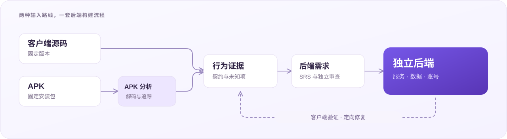

<div align="center">

[English](README.md) · **简体中文**

# REA-Backend

### 从客户端源码或 APK，构建可运行的后端。

发现需求，自主实现服务，通过实际客户端验证。

[工作流程](#工作流程) · [产出内容](#产出内容) · [开始使用](#开始使用) · [文档导航](#文档导航)

</div>

<p align="center">
  
</p>

REA-Backend 从 Android 客户端源码或 APK 中发现后端需求，编写经过审查的软件需求说明书（SRS），并构建独立服务。源码路线直接分析客户端；APK 路线通过检查与解码工具收集证据。两条路线共用需求、实现与验证流程。

在声明的功能范围内，既有客户端连接自主维护账号、业务数据和持久化的服务。每次运行记录获准输入、客户端连接调整以及尚未解决的缺口。原服务端实现不作为默认构建输入。

> [!NOTE]
> **首版独立实现。** 当前仓库包含 Python CLI、agent 工作流、模板和工程文档。本版聚焦可复用 pipeline；生成的 App 服务与输入材料单独维护。

## 为什么选择 REA-Backend

- **双路线，共用流程。** 接受客户端源码或 APK，保留各路线的证据边界。
- **从客户端行为发现需求。** 追踪请求构造、响应消费、状态变化、重试、资源与同步规则。
- **可审查的需求说明书。** 将需求关联到证据，保留未知项，在实现前审查关键行为。
- **尽早接入实际客户端。** 先验证一条完整工作流，再扩展并检查最终构建。
- **可追溯的构建历史。** 固定输入和方法版本，保留失败记录，将需求、实现与验证绑定到具体产物。

## 工作流程

| 阶段 | 工作 | 产出 |
| --- | --- | --- |
| **1. 准备** | 固定客户端版本、输入权限与范围；检查并解码 APK 输入。 | 输入身份与分析材料 |
| **2. 发现** | 追踪调用、消费者、状态、资源与完整工作流，记录发现和未解决问题。 | 证据与可续跑的分析记录 |
| **3. 规格化** | 冻结分析基线，编写后端需求，并独立审查关键行为。 | 经审查的 SRS 与版本绑定 |
| **4. 构建** | 基于 SRS 和同一路线采集的证据实现服务。 | 服务代码与需求到代码的映射 |
| **5. 验证** | 通过协议、持久化、资源检查及实际客户端验证选定工作流。 | 早期与最终验证记录 |
| **6. 交付** | 封装服务、依赖、运行说明与支撑记录。 | 可独立运行的后端工程包 |

验证结果反馈到对应阶段：需求缺口回到发现与规格化，实现偏差回到服务代码，环境问题回到运行配置。历史失败与基线持续保留。

宿主编程 agent 负责调查、文档编写与编程；CLI 负责记录检查、产物冻结、服务打包及显式验证计划执行。模型调度由宿主环境提供。

## 产出内容

一次完成的运行产出：

| 产物 | 内容 |
| --- | --- |
| **后端 SRS** | 功能需求、接口契约、数据模型、状态转换、验收条件与已知缺口 |
| **分析与审查记录** | 证据引用、调查历史、独立审查发现与方法版本 |
| **独立服务** | 声明范围内的后端代码、依赖、持久化与启动说明 |
| **实现映射** | 每条需求的已实现、部分实现或延期状态，以及本地设计决策 |
| **验证证据** | 检查项、客户端操作、存储断言、失败记录与实际受测构建 |

生成的服务可独立于分析工具和编程 agent 运行。原始客户端材料单独保留以便复现，不会自动随构建包分发。

## 开始使用

需要 **Python 3.12 或更新版本**。核心 CLI 使用 Python 标准库，没有必需的第三方 Python 运行时依赖。

```bash
git clone https://github.com/Pengxiang-zhao/REA-Backend.git
cd REA-Backend
python3 -m venv .venv
source .venv/bin/activate
python -m pip install .
rea-backend init-workspace --out workspace
```

这会创建包含工作流、参考文档和输入模板的工作目录。让宿主编程 agent 读取 `workspace/skills/rea-backend/SKILL.md`，然后提供客户端源码或 APK 及目标功能范围。工作流导出到本地，不会自动写入全局 agent 配置。

可以通过任一入口查看可用命令：

```bash
rea-backend --help
python -m rea_backend --help
```

APK 分析和 Android 验证所需的外部工具需要单独安装。环境准备和首次运行步骤见[入门指南](docs/getting-started.md)，也可以直接阅读[随包提供的 agent 工作流](src/rea_backend/resources/skills/rea-backend/SKILL.md)。

## 已有示例

此前的 pipeline 已在 **wallabag**、**ReadYou**、**Tempo**、**Grocy** 与 **Nextcloud** 上实践了源码和 APK 两条路线。

这些示例覆盖各自冻结方法版本下的选定工作流。每次运行记录具体范围、限制与验证结果。使用本独立安装包复跑这些工作流仍在路线图中。示例服务与 App 材料单独维护。

## 文档导航

配套工程文档统一使用英文。

| 文档 | 内容 |
| --- | --- |
| [入门指南](docs/getting-started.md) | 安装、工作目录配置、外部工具与首次运行 |
| [Agent 工作流](src/rea_backend/resources/skills/rea-backend/SKILL.md) | 阶段路由、交接要求与宿主编程 agent 使用说明 |
| [工程规格](docs/engineering.md) | 范围、架构、阶段、产物与鲁棒性机制 |
| [发布计划](docs/release-plan.md) | 当前版本范围与后续工作 |
| [致谢](docs/acknowledgments.md) | 上游工具与来源说明 |

## 路线图

- [ ] 使用独立安装包，沿源码和 APK 两条路线复跑实际 App 工作流。
- [ ] 通过缓存和执行工具减少重复工作，保留必要检查。
- [ ] 验证更多后端语言的依赖与启动配置。

## 常见问题

**这会恢复原服务端源码吗？**

它实现现有客户端证据能够支持的行为。隐藏规则保留为明确缺口；为继续构建引入的本地策略单独记录。

**会重新构建前端吗？**

当前核心产物是适配既有 Android 客户端的后端。通过服务地址设置或记录在案的客户端连接调整，接入生成的服务。

**CLI 会自动生成整个服务吗？**

宿主编程 agent 编写需求和服务，CLI 为这些工作提供确定性检查、打包与执行工具。

## 致谢

上游工具与来源说明见[致谢](docs/acknowledgments.md)。

文档基线日期：**2026 年 10 月 18 日**。
